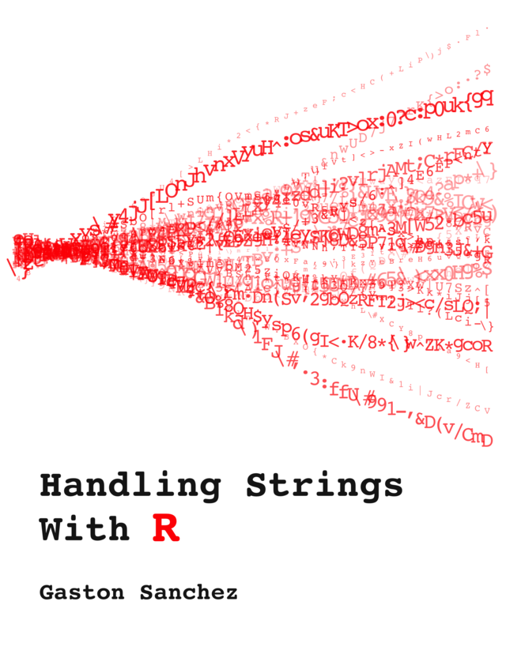

```{r setup, include=FALSE}
options(
  htmltools.dir.version = FALSE,
  dplyr.print_min = 6,
  dplyr.print_max = 6,
  tibble.width = 65,
  width = 65
)
knitr::opts_chunk$set(
  fig.width = 8,
  fig.asp = 0.5,
  out.width = "70%",
  fig.align = "center",
  dpi = 300
)
library(tidyverse)
library(scales)
library(readxl)
library(knitr)
library(babynames)
library(ggplot2movies)
```

<!-- Uses the original course img/ folder plus stat7500-slides.css.
Regex slides (meta-characters, character classes) removed; new slides prepare
students for week_12.qmd, Lab 08 (babynames), the movies exercise, and the
Phillies roster cleaning activity. -->


## Working with Strings

::: {.columns}

::: {.column width="50%"}
`stringr` package (in tidyverse)

Almost every function starts with `str_` and takes the string(s) as its first argument.
:::

::: {.column width="50%"}
[Handling Strings with R](https://leanpub.com/r4strings)

```{r echo=FALSE, out.width="50%"}

```
:::

:::

---

## stringr basics {.section-divider .middle}

---

## Reading in Character Strings from Files

```{r eval=FALSE}
read_file()    # reads entire file as single string
read_lines()   # creates vector of strings, each line separate
```

---

## Changing the Case

```{r}
str_to_lower("Villanova")
```

. . .

```{r}
str_to_upper("Go cats!")
```

. . .

```{r}
str_to_title("Make this look like a title of an article")
```

. . .

```{r}
str_to_sentence("Make This Look Like A Regular Sentence")
```

---

## Case matters when matching

String matching is case-sensitive.

```{r}
str_detect(c("Anna", "Joanne", "Hannah"), "ann")
```

. . .

Convert to one case first, then match:

```{r}
str_detect(str_to_lower(c("Anna", "Joanne", "Hannah")), "ann")
```

. . .

**Tip:** whenever you search names or titles, ask whether the pattern could appear at the *start* (capitalized) as well as in the middle.

---

## How long is a string?

```{r}
str_length(c("Ava", "Maximilian", "Zoe"))
```

. . .

Spaces and punctuation count as characters:

```{r}
str_length(c("Jaws", "Star Wars: A New Hope"))
```

---

## Substrings

```{r}
str_sub("Villanova", 1, 1)   # first character
str_sub("Villanova", 6, 9)   # characters 6 through 9
str_sub("Villanova", 6)      # from 6 to the end
str_sub("Villanova", -4)     # last 4 characters
str_sub("Villanova", -1)     # last character
```

Negative numbers count from the end, so `str_sub()` works no matter how long each string is.

---

## Find Character Strings

```{r eval=FALSE}
str_which(vector, pattern)      # returns indices of matches (grep in base R)
str_subset(vector, pattern)     # returns values of matches (grep with value = TRUE)
str_detect(vector, pattern)     # returns logical vector (grepl in base R)
```

. . .

```{r}
str_which(c("Aardvark","Anteater","Alligator"),"k")
```

. . .

```{r}
str_subset(c("Aardvark","Anteater","Alligator"),"k")
```

. . .

```{r}
str_detect(c("Aardvark","Anteater","Alligator"),"k")
```

---

## Starts with, ends with

```{r}
animals <- c("Aardvark", "Anteater", "Alligator", "Kangaroo")
str_starts(animals, "Al")
str_ends(animals, "r")
```

. . .

`str_starts()` and `str_ends()` return `TRUE`/`FALSE`, just like `str_detect()`, so they work inside `filter()` and `mutate()`.

---

## Matching any one of several characters

Square brackets mean "any one of these characters":

```{r}
str_detect(c("Aardvark","Anteater","Alligator"), "[gk]")
```

. . .

To check whether a single character is one of a set, `%in%` also works:

```{r}
last <- str_sub(animals, -1)
last
last %in% c("a", "e", "i", "o", "u")
```

---

## Your turn: State Names

*Exercise 1 in `week_08.qmd`*

Run each line and add a comment describing what it does.

```{r eval=FALSE}
str_which(state.name,"V")
str_subset(state.name,"V")
str_subset(str_to_upper(state.name),"V")
str_subset(state.name,"[Vv]")
```

---

## Find and Replace

```{r eval=FALSE}
str_replace(string, pattern, replacement)      # first occurrence
str_replace_all(string, pattern, replacement)  # all occurrences
str_remove(string, pattern)                    # remove first occurrence
str_remove_all(string, pattern)                # remove all occurrences
```

```{r eval=FALSE}
fruits <- c("one apple", "two pears", "three bananas")
str_remove(fruits, "[aeiou]")
str_remove_all(fruits, "[aeiou]")
```

. . .

```{r echo=FALSE}
fruits <- c("one apple", "two pears", "three bananas")
str_remove(fruits, "[aeiou]")
```

```{r echo=FALSE}
str_remove_all(fruits, "[aeiou]")
```

---

## Counting String Occurrence

```{r eval=FALSE}
str_count(string, pattern)
str_count("supercalifragilisticexpialidocious","[aeiou]") #returns 16
```

. . .

```{r eval=FALSE}
fruit <- c("apple","banana","pear","pineapple")
p_count <- str_count(fruit,"p")
fruit[p_count > 1]
```

. . .

```{r}
str_count(read_file("https://en.wikipedia.org/wiki/Villanova_University"),"Villanova")
```


---

## Special characters: use `fixed()`

Some characters (`? . * + ( ) [ ] $ ^`) have special meanings in a pattern.

```{r eval=FALSE}
str_detect(c("Why?", "Hello"), "?")          # Error!
```

. . .

Wrap the pattern in `fixed()` to match it literally:

```{r}
str_detect(c("Why?", "Hello"), fixed("?"))
str_remove_all(c("$20.00", "$40"), fixed("$"))
```

. . .

Ordinary characters like `:` or `-` need no special treatment.

---

<!-- ## Quotes inside strings -->

<!-- A string can contain the *other* kind of quote, or an escaped `\"`: -->

<!-- ```{r} -->
<!-- x <- c('She said "hi"', "It's fine", "6' 1\"") -->
<!-- x -->
<!-- writeLines(x)   # shows the string as it really is -->
<!-- ``` -->

<!-- `print()` shows escapes; `writeLines()` shows what is actually stored. -->

<!-- --- -->

## Paste (Concatenate)

```{r eval=FALSE}
paste("Pi is ", pi)
paste("Pi is about", round(pi,5))
paste("Pi=", pi)
paste("Pi=", pi, sep="")
paste0("Pi=", pi)  # shortcut

# Combine values:
paste("MAT", 1:5, sep="-")
```

---

## `sep` vs. `collapse`

```{r}
paste("MAT", 1:3, sep = "-")             # element by element
paste(c("a", "b", "c"), collapse = ", ") # squash a vector into one string
```

. . .

`str_c()` is the stringr version:

```{r}
str_c("MAT", 1:3, sep = "-")
str_c(c("a", "b", "c"), collapse = ", ")
```

---

## Using Paste in Plot Labels {.nostretch}

```{r out.width="55%"}
ggplot(mtcars, aes(x = wt, y = mpg)) +
  geom_point() +
  geom_smooth(method = "lm") +
  labs(subtitle = paste("Correlation =", round(cor(mtcars$wt,mtcars$mpg),4)))
```

---

## Strings in a data frame {.section-divider .middle}

---

## The babynames data

```{r}
library(babynames)
glimpse(babynames)
```

. . .

Each row is a **name × sex × year** combination, not one baby.

- `n`: number of babies given that name that year
- `prop`: `n` divided by the total babies of that sex that year

---

## Create new variables with string functions

String functions are vectorized, so they work inside `mutate()`:

```{r}
babynames |>
  mutate(
    first_two = str_sub(name, 1, 2),
    has_z     = str_detect(str_to_lower(name), "z")
  ) |>
  select(year, sex, name, first_two, has_z)
```

---

## Filter rows with string functions

```{r}
babynames |>
  filter(sex == "F", str_starts(name, "Ann"), name != "Ann") |>
  distinct(name)
```

`filter()` keeps rows where the condition is `TRUE`, so any `str_detect()`, `str_starts()`, or `str_ends()` call can go inside it.

---

## Names or babies? Know what you are counting

```{r}
toy <- tibble(name = c("Ava", "Maximilian", "Zoe"),
              n    = c(1000, 5, 10))
```

. . .

::: {.columns}

::: {.column width="50%"}
**Per name** (each row counts once)

```{r}
nrow(toy)
mean(str_length(toy$name))
```
:::

::: {.column width="50%"}
**Per baby** (weight by `n`)

```{r}
sum(toy$n)
weighted.mean(str_length(toy$name), toy$n)
```
:::

:::

Decide which question you are answering before you summarise.

---

## Counts or proportions? {.nostretch}

::: {.columns}

::: {.column width="60%"}
```{r out.width="100%"}
babynames |>
  group_by(year) |>
  summarise(total_babies = sum(n)) |>
  ggplot(aes(x = year, y = total_babies)) +
  geom_line() +
  scale_y_continuous(labels = label_comma())
```
:::

::: {.column width="40%"}
- **Counts** answer *how many babies?* Use them for totals and rankings.
- **Proportions** answer *how common, relative to all babies that year?* Total births change a lot, so use proportions to compare popularity across years.
:::

:::

---

<!-- ## A pattern you will reuse -->

<!-- What share of babies, each year and sex, have a name ending in "n"? -->

<!-- ```{r} -->
<!-- ends_n <- babynames |> -->
<!--   mutate(ends_in_n = str_ends(name, "n")) |> -->
<!--   group_by(year, sex) |> -->
<!--   summarise(prop_n = sum(n[ends_in_n]) / sum(n), .groups = "drop") -->

<!-- ends_n -->

<!-- babynames |> -->
<!--   mutate(ends_in_n = str_ends(name, "n")) |> -->
<!--   group_by(year, sex) |> -->
<!--   summarise(prop_n = n / sum(n)) -->
<!-- ``` -->

<!-- Flag rows with a string function → group → sum `n` → divide. -->

<!-- --- -->

<!-- ## ...then plot it {.nostretch} -->

<!-- ```{r out.width="60%"} -->
<!-- ggplot(ends_n, aes(x = year, y = prop_n, color = sex)) + -->
<!--   geom_line() + -->
<!--   scale_y_continuous(labels = label_percent()) + -->
<!--   labs(x = "Year", y = "Share of babies", color = "Sex", -->
<!--        title = 'Names ending in "n"') -->
<!-- ``` -->

---

## Strings in other data: movies

```{r}
library(ggplot2movies)
movies |>
  select(title, year, rating) |>
  mutate(title_length = str_length(title),
         has_colon    = str_detect(title, ":"))
```


---

## Need something fancier?

The patterns we used are a small piece of **regular expressions** (regex).

When you need a complex pattern, describe in words what you want to match and ask AI for the regex.

Just make sure to double check that it works as expected!

---

## Your turn: babynames & movies

*Exercises 2–6 in `week_08.qmd`*

Before you code each question, decide:

- What string function creates the variable you need?
- Am I counting **names** (rows) or **babies** (`sum(n)`)?
- Should I compare **counts** or **proportions** across years?

---

## Splitting and combining columns {.section-divider .middle}

---

## One column holding two values

```{r}
courses <- tibble(course = c("STAT-7500", "MAT-1505", "CSC-1051"))

courses |>
  separate_wider_delim(course, delim = "-",
                       names = c("dept", "number"))
```

`separate_wider_delim()` splits one column into several at a delimiter.

You may see `separate()` online; it still works but has been superseded by the `separate_wider_*()` functions.

---

## When the pieces don't line up

```{r}
addresses <- tibble(addr = c("800 Lancaster Ave", "1 Main St",
                             "30 South Ithan Ave"))
```

Splitting on `" "` gives a different number of pieces per row. Use `too_many = "merge"` to keep the rest together:

```{r}
addresses |>
  separate_wider_delim(addr, delim = " ", too_many = "merge",
                       names = c("number", "street"))
```

---

## Text that should be numbers

```{r}
x <- c("$20.00", "45 min", "1,250")
parse_number(x)
```

. . .

`parse_number()` drops non-numeric characters before and after the number.

```{r}
times <- tibble(time = c("2h 15m", "1h 5m"))

times |>
  separate_wider_delim(time, delim = " ", names = c("hours", "minutes")) |>
  mutate(total_min = parse_number(hours) * 60 + parse_number(minutes))
```

---

## `unite()`: the reverse

```{r}
tibble(dept = c("STAT", "MAT"), number = c(7500, 1505)) |>
  unite(col = "course", dept, number, sep = "-")
```

`unite()` pastes columns together inside a data frame.

---

## Data spread across Excel sheets

```{r eval=FALSE}
path <- "data/roster.xlsx"
excel_sheets(path)                      # list the sheet names

sheet_a <- read_excel(path, sheet = "Sheet A")
sheet_b <- read_excel(path, sheet = "Sheet B")

bind_rows(A = sheet_a, B = sheet_b, .id = "source")
```

`bind_rows()` stacks data frames with the same columns. `.id` records which one each row came from.

---

## Your turn: Phillies roster

The roster is in one Excel file with four sheets: Pitchers, Catchers, Outfielders, Infielders.

Each sheet has `Name`, `B/T`, `Ht`, `Wt`, and `DOB` columns.

**List every cleaning step** you would need to get these data into one tidy, analysis-ready data frame. Don't worry about exact code yet.

---

## More on dates and times {.section-divider .middle}

---

## Recap: parse first

Last week: match the parser to the **input** format.

```{r}
trips <- tibble(
  start_time = c("2025-03-07 08:15:00", "2025-03-08 17:42:00",
                 "2025-03-09 23:55:00"),
  end_time   = c("2025-03-07 08:32:30", "2025-03-08 18:10:00",
                 "2025-03-10 00:20:00")
) |>
  mutate(across(c(start_time, end_time),
                \(x) ymd_hms(x, tz = "America/New_York")))
trips
```

Use the time zone the data source records in (check its documentation). Here we assume local Philadelphia time.

---

## Pull out the pieces you need

```{r}
trips |>
  mutate(
    date    = as_date(start_time),
    month   = month(start_time, label = TRUE),
    weekday = wday(start_time, label = TRUE),
    hour    = hour(start_time)
  ) |>
  select(-end_time)
```

`label = TRUE` returns an **ordered factor**, so months and weekdays plot in calendar order, not alphabetical.

---

## Weekday or weekend?

```{r}
trips |>
  mutate(
    weekday = wday(start_time, label = TRUE),
    weekend = weekday %in% c("Sat", "Sun")
  ) |>
  select(start_time, weekday, weekend)
```

**Check by hand:** look up one date on a calendar and confirm R agrees.

---

## When files disagree on format

Different files (or different quarters) may write the same moment differently:

```{r}
x <- c("2025-03-07 08:15:00", "3/8/2025 17:42")
ymd_hms(x)
```

. . .

`parse_date_time()` accepts several possible formats:

```{r}
parse_date_time(x, orders = c("ymd HMS", "mdy HM"),
                tz = "America/New_York")
```

---

## Always check what parsing did

A failed parse becomes `NA`, often with only a warning.

```{r eval=FALSE}
trips_parsed |>
  summarise(
    raw_missing    = sum(is.na(start_time_raw)),
    parsed_missing = sum(is.na(start_time))
  )
```

- If `parsed_missing` > `raw_missing`, some values failed to parse. Find those rows and look at them.
- Check the earliest and latest dates (`min()`, `max()`): do they match the files you read?
- If `bind_rows()` complains about combining `<datetime>` and `<character>`, the files were read with different types. Make the types match before you stack them.

---

## Time between two date-times

Subtracting date-times gives a **difftime**. Choose the units yourself:

```{r}
trips |>
  mutate(minutes = as.numeric(difftime(end_time, start_time,
                                       units = "mins"))) |>
  select(start_time, end_time, minutes)
```

Useful for checking a recorded duration column against the start and end times.

---

## Rounding down to a day, week, or month

```{r}
floor_date(trips$start_time, unit = "day")
floor_date(trips$start_time, unit = "week")    # weeks start on Sunday
floor_date(trips$start_time, unit = "month")
```

Group by the floored date to count trips per week or per month.

---

## Joining trips to daily weather

Weather data have **one row per day**; trips have one row per trip. Summarise trips to days first, then join on a `Date`:

```{r}
weather <- tibble(DATE = ymd(c("2025-03-07", "2025-03-08", "2025-03-09")),
                  TMAX = c(52, 61, 70))

trips |>
  mutate(date = as_date(start_time)) |>
  count(date, name = "n_trips") |>
  left_join(weather, by = c("date" = "DATE"))
```

Both keys must be the same type (`Date` and `Date`). A date stored as text will not match.

---

